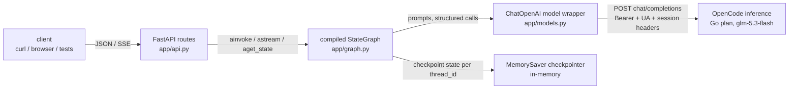
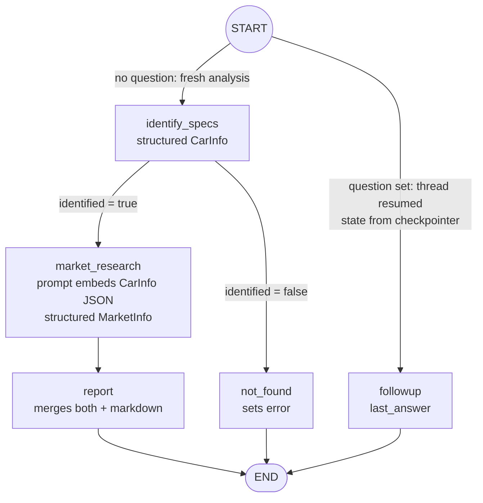
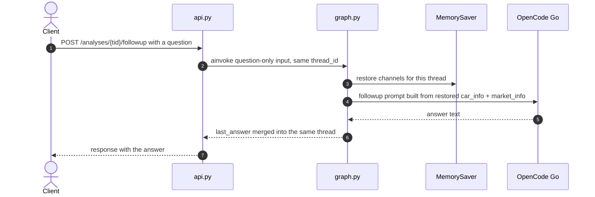
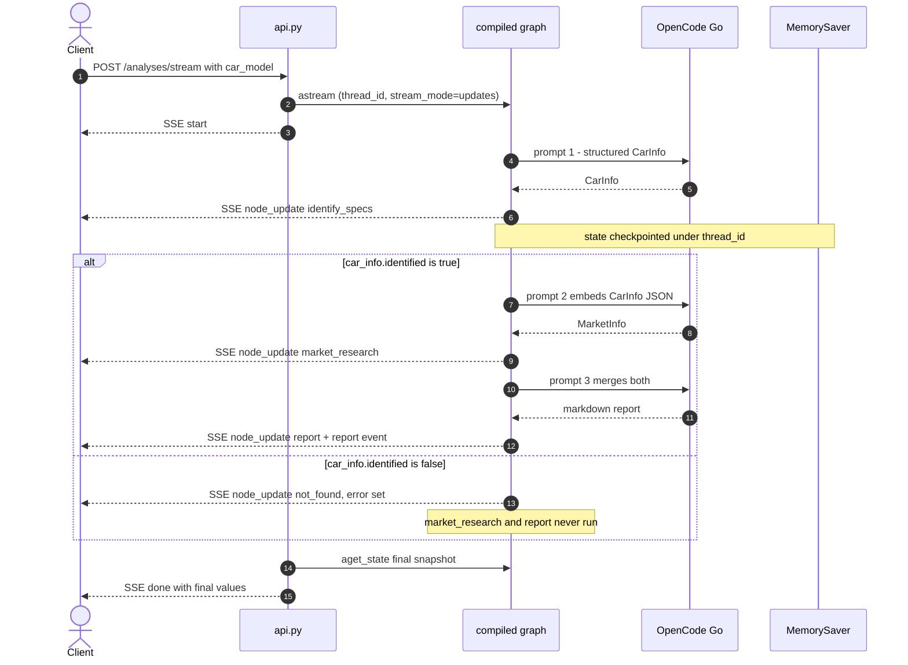

# Understanding LangChain & LangGraph through the car analyzer

> **TL;DR** — This project calls one LLM endpoint three times: (1) extract facts
> about a car, (2) estimate its market context **using step 1's output**, (3)
> merge everything into a markdown report. **LangChain** is the Swiss knife that
> tames every single call (the HTTP client, message objects, and structured
> output); **LangGraph** is the state machine that orchestrates the sequence,
> branches, checkpointing and streaming around those calls. This document
> explains both at the level of "what exactly is each one doing here, and what
> would I have to hand-write without it".
>
> Runnable reference: see `README.md` for setup/curls; code lives in `app/`.

---

## 1. The project in 30 seconds

- `POST /analyses` — runs the full chain synchronously, returns the report.
- `POST /analyses/stream` — same chain, but streamed as **SSE events** so you
  can watch each node fire (`node_update: identify_specs → market_research →
  report`).
- `POST /analyses/{thread_id}/followup` — asks a follow-up question that
  **resumes** a previously persisted analysis (the graph state comes back from
  the checkpointer, previous steps do *not* re-run).
- `GET /analyses/{thread_id}` — inspects the persisted state.

What belongs to which technology:

| Concern | Owned by |
|---|---|
| HTTP transport, SSE framing, validation | FastAPI (`app/api.py`) — not LangChain |
| LLM calls, message model, structured output | **LangChain** (`app/models.py`, nodes in `app/graph.py`) |
| Orchestration: order, branching, state, persistence, progress | **LangGraph** (`app/graph.py`) |
| LLM endpoint, billing, auth headers | OpenCode inference API (env config) |

---

## 2. The two libraries in one picture



Dependency direction is strict: `api.py → graph.py → models.py → OpenCode`.
Nothing below LangChain knows about HTTP; nothing above it knows about LLMs.
That split is cheap to keep here and is precisely what makes the offline test
suite possible (a fake LLM replaces `models.py`, the same graph runs without a
network).

---

## 3. What LangChain does here — and what it silently takes over

LangChain's job in this project is deliberately small, but it is the layer that
touches every LLM call. Three roles, in order of effort saved:

### 3.1 The model client (`app/models.py`)

```python
return ChatOpenAI(
    model=os.getenv("OPENCODE_MODEL", DEFAULT_MODEL),
    base_url=os.getenv("OPENCODE_BASE_URL", DEFAULT_BASE_URL),
    api_key=api_key,
    temperature=0.2,
    timeout=120,
    max_retries=1,
    default_headers=_default_headers(),
)
```

`ChatOpenAI` is not "an OpenAI model". It is an **OpenAI-dialect adapter**
pointed at any compatible server. In this project that server is OpenCode's
inference endpoint (`/inference/go/openai/v1`); with one env change it could be
Ollama, vLLM, or OpenAI itself. Without changing any node code:

- it assembles `POST {base_url}/chat/completions` with the right JSON body;
- it adds `Authorization: Bearer <key>` and our custom identification headers
  (`User-Agent`, `x-opencode-session`) on every request;
- it parses the response object, including usage/billing fields;
- it applies the timeout and does one automatic retry on transient failures.

### 3.2 Messages without ceremony

Nodes never build provider-specific JSON. They declare *intent*:

```python
llm.invoke(
    [
        ("system", "You write concise car-analysis reports in markdown."),
        ("human",   f"Car: {car} ..."),
    ]
)  # -> AIMessage; .content is the plain text answer
```

LangChain converts those ("system", "human") tuples into the wire format
(`{"role": "system", "content": ...}`), keeps higher-level message types
(tool calls, images) possible later, and normalizes what comes back into an
`AIMessage` object. Small task, but it is the *shared vocabulary* that the rest
of the stack builds on. It also produced a real bug-fix during development:
the plain-text calls return an `AIMessage`, and the `followup` node initially
stored the whole object in state instead of `.content` — tests caught it.

### 3.3 Structured output — the real workhorse

```python
car_info = llm.with_structured_output(CarInfo).invoke(...)   # -> CarInfo instance
```

One line hides the contract enforcement that people usually hand-roll forever:

1. converts the **Pydantic schema** into the provider's structured dialect
   (JSON-schema function calling) and sends the schema *with the request*;
2. constrains the model toward that shape;
3. parses whatever comes back into a validated `CarInfo` instance;
4. raises a typed error when the production violates the schema — so our
   conditional edge (`car_info.identified`) can be **trusted as plain Python**.
   The modeling is deliberate: the schema *is* the API between step 1 and step 2
   (step 2's prompt embeds `car_info.model_dump_json()` verbatim).

This is the most valuable LangChain feature in the project: every LLM boundary
comes back as a typed object, not a string to be parsed with hope.

### 3.4 What it quietly replaces

- URL/body construction per provider dialect, and per-dialect differences
  (OpenAI `choices`, Anthropic `messages`, …).
- Auth, custom headers, timeouts, retry/backoff policy.
- Response normalization (`AIMessage` + usage/cost metadata).
- The structured-output loop (schema payload → constrained generation → parse
  → validate → fail early).
- Streaming token/usage event parsing when you want it later.

---

## 4. The counterfactual — step 1 *without* LangChain

Nothing is stopping you from using `httpx` directly. Here is the same
`identify_specs` call, hand-rolled:

```python
import httpx, json

def identify_specs_raw(car_model: str, year: int | None) -> CarInfo:
    body = {
        "model": os.environ["OPENCODE_MODEL"],
        "messages": [
            {"role": "system", "content": SPECS_SYSTEM_PROMPT},
            {"role": "user", "content": f"Car requested: {car_model}\nExtract the key facts."},
            # + a paragraph pleading with the model to answer ONLY as JSON...
        ],
        "tools": [{"type": "function", "function": {"name": "CarInfo",
                    "parameters": jsonschema_of(CarInfo)}}],  # ...or manual tool schema
    }
    resp = httpx.post(
        f"{os.environ['OPENCODE_BASE_URL']}/chat/completions",
        json=body,
        headers={"Authorization": f"Bearer {os.environ['OPENCODE_API_KEY']}"},
        timeout=120,
    )
    resp.raise_for_status()
    raw = resp.json()["choices"][0]["message"]["content"]
    return CarInfo.model_validate(json.loads(raw))  # good luck on the first try
```

That is the *happy* version. The real checklist you inherit per provider, per
call site:

- unwrap `choices[0].message.content`, which sometimes arrives with ` ```json `
  fences around it;
- retry the validation loop when the model forgets a field or invents one;
- implement your own timeout + retry/backoff handling;
- redo all of this if the provider speaks a different dialect;
- keep the structuring constraints out-of-band. Once your schema changes, you
  must chase every prompt where you described the shape by hand.

None of this is wizardry — it is ~40 lines of plumbing per call that LangChain
compresses to `llm.with_structured_output(CarInfo).invoke(...)`. That is the
honest value proposition: not capability, but the **deletion of per-call glue
you would otherwise write four times** in this project alone.

---

## 5. What LangGraph does here

LangGraph models the pipeline as a **graph**: a shared typed **state**, plain
**node functions** that receive the state and return a *partial update to it*,
directed **edges**, and **router functions** that decide the next node. The
whole orchestration lives in one file, `app/graph.py`.

### 5.1 The state is the truth

```python
class CarAnalysisState(TypedDict):
    car_model: str
    year: int | None
    question: str | None          # set only on follow-up turns
    car_info: CarInfo | None      # step 1
    market_info: MarketInfo | None  # step 2 (built FROM car_info)
    report: str | None            # step 3 (merges car_info + market_info)
    error: str | None             # set by not_found
    last_answer: str | None       # set by followup
```

Each key is a **channel**: parallel updates merge into it, and every node only
ever writes the keys it is responsible for. Node functions are pure
`state → dict` transformations, which is why they are unit-testable with no
framework at all (see `tests/test_graph.py`).

### 5.2 Nodes, routers and wiring

```python
builder = StateGraph(CarAnalysisState)
builder.add_node("identify_specs", identify_specs)      # structured CarInfo
builder.add_node("market_research", market_research)    # structured MarketInfo
builder.add_node("report", report)                      # plain-text merge
builder.add_node("not_found", not_found)                # error + early exit
builder.add_node("followup", followup)                  # Q&A over saved state

builder.add_conditional_edges(START, start_router,          # fresh run vs follow-up
    {"identify_specs": "identify_specs", "followup": "followup"})
builder.add_conditional_edges("identify_specs", route_after_specs,
    {"market_research": "market_research", "not_found": "not_found"})
builder.add_edge("market_research", "report")
for node in ("report", "not_found", "followup"):
    builder.add_edge(node, END)
graph = builder.compile(checkpointer=checkpointer)
```

Routers are ordinary Python functions (`route_after_specs` returns
`"market_research"` or `"not_found"`) — branching logic you can assert on
directly. The full picture:



The one behavior your original spec asked for is exactly the
`identify_specs → market_research` edge: step 2's prompt *embeds step 1's
serialized output*, so the second call reasons over what the first one
retrieved.

### 5.3 The execution engine (what actually runs it)

A compiled LangGraph executes in **supersteps** — synchronous rounds of "run
every node that is currently callable, merge all returned diffs into channels
atomically, then schedule the next round". This project's edges are sequential,
so each superstep runs exactly one node. That machinery sounds heavy for a
chain — until you realize it is what later gives you, without new framework
code:

- **parallelism**: adding a second analyst node alongside `market_research`
  would run in the *same* superstep (see experiment ideas, §10);
- **cycles**: a self-check/retry loop is one edge back to an existing node
  plus a counter in state;
- **resumability and streaming** (next two subsections).

### 5.4 Checkpointing buys the follow-up feature

`graph = builder.compile(checkpointer=MemorySaver(...))` and every call carries
`config={"configurable": {"thread_id": ...}}`. MemorySaver then snapshots the
state after every superstep.

The follow-up endpoint is the payoff:

```python
snapshot = await graph.aget_state(config)          # does that thread exist?
final = await graph.ainvoke({"question": req.question}, config=config)
```

The second invoke sends **only** `{"question": ...}`. LangGraph loads the
thread's channels from the checkpointer, `start_router` sees a question set →
routes to the `followup` node, and the node composes its prompt from the
*persisted* `car_info` + `market_info` (test asserts specs/market steps ran
exactly once). Persisted state is also exposed for debugging via `GET /analyses/{thread_id}`.



One maintenance lesson came from here, live: checkpoints serialize the Pydantic
objects, and newer LangGraph versions only allow that for explicitly
allowlisted types:

```python
_CHECKPOINT_SERIALIZER = JsonPlusSerializer(allowed_msgpack_modules=[CarInfo, MarketInfo])
checkpointer = checkpointer or MemorySaver(serde=_CHECKPOINT_SERIALIZER)
```

### 5.5 Streaming progress — `astream` + SSE

For the SSE endpoint the server does not need a new orchestration layer; it
asks the *same compiled graph* to stream:

```python
async for chunk in graph.astream(input, config=config, stream_mode="updates"):
    for node_name, update in chunk.items():  # one dict {node: state-delta} per superstep
        yield sse({"event": "node_update", "node": node_name, "data": ...})
```

`stream_mode="updates"` gives one event **per superstep** with the exact diff
that node produced — the app forwards those over SSE, plus a final `report`
event extracted from the last update. Real output from the live run:

```text
data: {"event": "node_update", "node": "identify_specs", "data": {"car_info": {...}}}
data: {"event": "node_update", "node": "market_research", "data": {"market_info": {...}}}
data: {"event": "node_update", "node": "report", "data": {"report": "# 2022 Toyota Corolla ..."}}
data: {"event": "done", "thread_id": "c4d3f6b8-...", ...}
```

The full picture of a streamed first turn, including its failure branch:



---

## 6. The counterfactual — this pipeline *without* LangGraph

For a fixed three-step chain, the honest answer is: a plain function is fine.

```python
async def analyze(car_model: str, year: int | None) -> Analysis:
    car = await identify_specs(car_model, year)
    if not car.identified:
        return Analysis(error=f"Could not identify '{car_model}'.")
    market = await market_research(car)
    return Analysis(car_info=car, market_info=market, report=await write_report(car, market))
```

That is *less* code and you should be able to defend it. What you give up is
exactly the set of features this project exists to exercise:

| LangGraph mechanism | Your hand-rolled equivalent | What breaks or gets lost |
|---|---|---|
| Typed shared state with channel merge | function args / one mutable dict mutated in place | mutation ceremony grows with every step; arguments drift apart |
| Node as unit-of-work (`state → diff`) | an `await`ed call | identical for linear flows — pays off when multiple nodes share a superstep |
| Conditional edges (routers) | an `if` in the function | branch logic stops being a named, independently testable artifact; the flow is visible only by reading code |
| Checkpointer + `thread_id` | your own `dict[thread, state]` + a serializer | no resume-later, no `aget_state` debug window, and DB-backed persistence wires are pure DIY |
| `astream("updates")` | per-node logging or a bespoke callback registry | progress events must be re-wired whenever a node is added |
| Parallel supersteps | hand-managed `asyncio.gather` + fan-in merge | every new parallel branch re-edits the orchestration code |

Verdict: use LangGraph when **routing, durability, parallelism or progress
visibility** will grow — i.e., when control flow *is* the domain. For a truly
fixed linear flow, write the function. This project intentionally sits on the
page: simple enough to understand fully in an hour, yet every LangGraph
feature appears naturally.

---

## 7. State evolution, superstep by superstep

First turn, happy path (`POST /analyses {"car_model": "Toyota Corolla", "year": 2022}`):

| Superstep | executing node | channels written | channels not yet set |
|---|---|---|---|
| 1 | identify_specs | `car_info` (identified=true, make=Toyota, ...) | market_info, report |
| 2 | market_research | `market_info` (price_low=16500, price_high=24000, ...) | report |
| 3 | report | `report` (markdown merge of both sections) | — |

Not-found path (`{"car_model": "Flying Falcon 3000X"}`): superstep 1 →
conditional edge routes to `not_found`, writing only `error`; execution ends
after one superstep.

Follow-up turn on thread `c4d3f6b8-...` (`{"question": "Is the hybrid cheaper?"}`):

| Superstep | executing node | channels written | channels restored from checkpointer |
|---|---|---|---|
| 1 | followup | `last_answer` | car_model, year, car_info, market_info, report |

The nuance that produced a real test fix: the merged state dict returned by
`invoke`/`astream` chunks contains **only channels that were written in this
run** — never assume `result["report"]` exists (hence `state.get(...)`).

---

## 8. Benefits — and where they bite

**What LangChain + LangGraph bought this project:**

- Provider-agnostic LLM endpoint (change `OPENCODE_BASE_URL`, zero node
  changes) with auth/header/timeout/retry handled once.
- Typed boundaries everywhere: `CarInfo`/`MarketInfo` instead of prompt parsing.
- A visible, inspectable program: the graph wiring reads like the architecture;
  routers and nodes are individually assertable; `aget_state` is a free
  debugging window.
- Multi-turn for free: follow-up endpoint is ~15 lines because checkpointing
  does state management.
- Progress streaming as data: `astream` → SSE took one generator; adding nodes
  wouldn't change the streaming layer.
- Future-proof extension points (parallel nodes, cycles, swapping the
  checkpointer for persistent storage).

**Where the abstraction bites (all met for real):**

- Merge semantics have rules you must learn: return *diffs*, not full state;
  untouched channels keep the previous values; `invoke` results only contain
  touched channels.
- Feel-before-flow: serialization/checkpointing introduces a type-registry
  concern (the msgpack allowlist) that a plain loop never had.
- Per-request LLM headers (e.g. one `x-opencode-session` per analysis) don't
  fit `ChatOpenAI`'s per-model defaults — a custom client would be needed.
- `MemorySaver` is per-process; real durability means swapping in
  `SqliteSaver`/`PostgresSaver`.

---

## 9. Glossary

| Term | Meaning here |
|---|---|
| **channel** | one key of the state (`car_info`), with per-node read/write + merge rules |
| **node** | plain function `state → partial state`; one unit of LLM work |
| **router** | function returning the name of the next node; used by `add_conditional_edges` |
| **superstep** | engine "tick": run all currently-callable nodes concurrently, merge diffs atomically |
| **thread** | one persisted conversation keyed by `thread_id` (an analysis, here) |
| **checkpointer** | saves a serialized checkpoint per superstep per thread (`MemorySaver` + `JsonPlusSerializer` allowlist) |
| **compiled graph** | the runnable object: `invoke` / `ainvoke` / `astream` / `aget_state` |
| **update mode ("updates")** | `astream(stream_mode="updates")` emits `{node: delta}` per superstep (powers SSE) |

---

## 10. Experiments to make the concepts muscle memory

1. **Parallel supersteps** — add a `safety_analysis` node fed by the same
   `identify_specs` step (one extra node + one edge). Check the SSE events:
   both nodes complete in the *same* superstep window, and `report` then reads
   both channels.
2. **A cycle** — after `report`, add `verify` that returns either `END` or
   `report` (via a router that increments a `revision` counter in state).
   Conditional edges to closed loops: the engine handles revisiting nodes.
3. **Token-level streaming** — switch the SSE app generator to
   `graph.astream_events(...)` and/or stream the report node with
   `llm.stream(...)`; compare the event granularity with
   `stream_mode="updates"`.
4. **Durable threads** — replace `MemorySaver` with
   `langgraph-checkpoint-sqlite`'s `SqliteSaver`; restart the API; the
   follow-up endpoint still resumes the old thread. Proof that the checkpointer
   is an interface, not a specific implementation.
5. **Billing visibility as an event** — read the per-request
   `usage_metadata`/`response_metadata` (LangChain normalizes it) and emit an
   SSE `usage` event with `opencode.allowance`/`billing_source`.
6. **Per-thread session headers** — implement a minimal custom
   OpenAI-compatible client replacing `ChatOpenAI` that sets a
   `x-opencode-session` per thread, to feel what the abstraction encodes.

---

## Appendix — debugging diary (all real, all verified by tests)

1. `with_structured_output` returns a **chain**, i.e. an object with
   `.invoke(...)` — when we faked one in tests as a bare function, LangChain's
   call shape exposed the mistake immediately.
2. **State diffs**: an `invoke` result only carries channels written in that
   run — assuming `result["report"]` exists raised `KeyError` and forced the
   `state.get(...)` convention.
3. **`.content` discipline**: plain-text invocations return an `AIMessage`;
   the follow-up node initially stored the message object itself in state.
4. **Checkpoint type registry**: persisting Pydantic objects in
   state means registering them in the checkpoint serializer (msgpack
   allowlist) — permissive defaults warn today and will hard-block tomorrow.
5. **Config before code**: two failures upstream (`HTTP 403` for free-tier
   models called externally, and `404`-on-auth caused by putting
   `/chat/completions` inside the base URL) are both documented in
   `.env.example` so the next person burns zero time on them.
